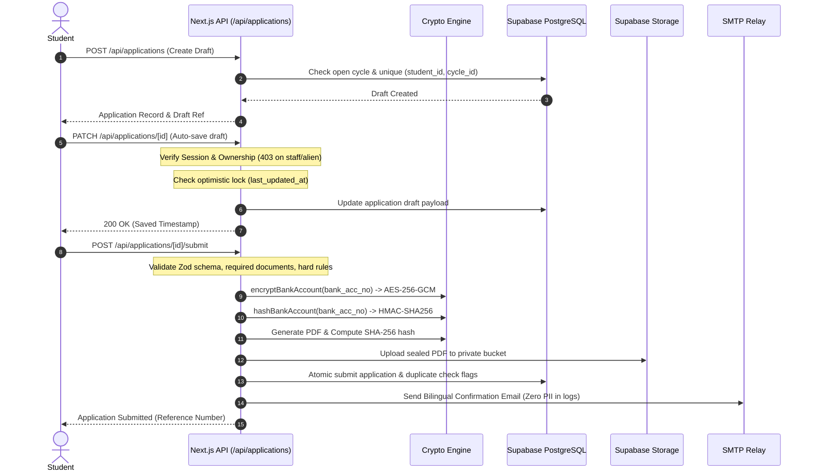
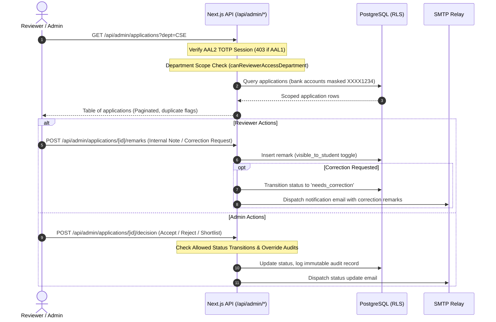

# System Architecture

## 1. System Overview

The **SIT Scholarship Application Portal** is an enterprise-grade web application built for the **Siddaganga Institute of Technology (SIT), Tumkur**, designed to administer institutional scholarships—primarily the **M.N. Channabasappa (MNC)** Scholarship and the **Siddaganga Sree Shivakumara Swamigalu (SSKA)** Scholarship.

The system is designed with a **privacy-first, defense-in-depth** security model compliant with the **Digital Personal Data Protection Act (DPDP) 2023**.

```mermaid
graph TD
    subgraph Client Browser
        A[Student / Applicant]
        B[Department Reviewer]
        C[Institutional Administrator]
    end

    subgraph Next.js 16 Application Server (Turbopack)
        P[Proxy / Origin Guard / CSP]
        Auth[Auth & MFA Controller /api/auth/*]
        Wiz[Application Wizard /api/applications/*]
        Adm[Admin Suite /api/admin/*]
        PDF[PDF Engine & SHA-256 Seal]
        Mail[SMTP Notifier (Nodemailer)]
    end

    subgraph Supabase BaaS (AWS Mumbai ap-south-1)
        DB[(PostgreSQL 15+ & RLS)]
        Store[(Private Storage Buckets)]
        Rate[(Atomic Rate Limiter RPC)]
        Audit[(Immutable Audit Logs)]
    end

    subgraph External Services
        CF[Cloudflare Turnstile CAPTCHA]
        SMTP[Campus SMTP Relay @sit.ac.in]
    end

    A -->|HTTPS / Port 443| P
    B -->|HTTPS / AAL2 TOTP| P
    C -->|HTTPS / AAL2 TOTP| P

    P --> Auth
    P --> Wiz
    P --> Adm
    
    Auth --> CF
    Auth --> DB
    Auth --> Rate
    
    Wiz --> DB
    Wiz --> Store
    Wiz --> PDF
    Wiz --> Mail

    Adm --> DB
    Adm --> Store
    Adm --> Audit
    Adm --> Mail

    Mail --> SMTP
```

---

## 2. Technology Stack

- **Framework:** Next.js 16.4 (App Router, Turbopack)
- **Language:** TypeScript 5.x (Strict mode, zero `any` policy)
- **Database:** Supabase PostgreSQL 15+ (Row Level Security enforced, triggers, functions)
- **Object Storage:** Supabase Storage (Private buckets: `application-files`, `application-pdfs`)
- **Styling:** Vanilla CSS & Government/Institutional Design System (responsive, mobile-first, print-optimized)
- **Authentication:** Supabase Auth with TOTP Multi-Factor Authentication (AAL1 for students, AAL2 mandatory for staff)
- **Cryptographic Primitives:**
  - AES-256-GCM for sensitive field encryption at rest
  - HMAC-SHA256 for privacy-preserving blind bank account deduplication
  - SHA-256 for tamper-evident PDF document sealing
- **Bot Defense:** Cloudflare Turnstile CAPTCHA
- **Email Transport:** Nodemailer via direct institutional SMTP relay

---

## 3. Data Flow & Security Boundaries

### 3.1 Student Application Lifecycle


### 3.2 Staff Scrutiny & Scoped Review Flow


---

## 4. Role Authorization Matrix

The portal defines four discrete actor roles:

| Action / Resource | Student (AAL1) | Reviewer (AAL2) | Administrator (AAL2) | Anonymous Visitor |
| :--- | :---: | :---: | :---: | :---: |
| View Public Scholarship Information | :white_check_mark: | :white_check_mark: | :white_check_mark: | :white_check_mark: |
| Apply & Edit Own Draft | :white_check_mark: | :x: (403 Forbidden) | :x: (403 Forbidden) | :x: |
| Upload Files to Own Application | :white_check_mark: | :x: | :x: | :x: |
| Withdraw Own Application | :white_check_mark: | :x: | :x: | :x: |
| View Assigned Applications | :x: | :white_check_mark: (Scoped to Dept) | :white_check_mark: (All Departments) | :x: |
| Add Scrutiny Remarks & Notes | :x: | :white_check_mark: | :white_check_mark: | :x: |
| Request Application Correction | :x: | :white_check_mark: | :white_check_mark: | :x: |
| Mark Hard-Copy Received | :x: | :white_check_mark: | :white_check_mark: | :x: |
| Decide Application (Shortlist/Accept/Reject) | :x: | :x: (403 Forbidden) | :white_check_mark: | :x: |
| Decrypt Full Student Bank Account | :white_check_mark: (Own only) | :x: (Masked `XXXX1234`) | :white_check_mark: (Audited Log) | :x: |
| Bulk Shortlisting & Merit Ranking | :x: | :x: | :white_check_mark: | :x: |
| Manage Users & Reset Staff MFA | :x: | :x: | :white_check_mark: | :x: |
| View Immutable Audit Logs | :x: | :x: | :white_check_mark: | :x: |
| Manage Academic Cycles & Rules | :x: | :x: | :white_check_mark: | :x: |

---

## 5. Reviewer Department Scoping Model

To prevent unauthorized cross-department data exposure, reviewers are assigned to specific academic departments via the `profiles.reviewer_departments` array column (e.g. `['Computer Science and Engineering', 'Information Science and Engineering']`).

The backend function `canReviewerAccessDepartment(reviewerDepts, studentDept)` enforces:
1. Administrators (`role === 'admin'`) have unrestricted access across all departments.
2. Reviewers without departmental restrictions (`reviewer_departments IS NULL` or empty) can view all departments.
3. Reviewers with assigned departments can **only** query, scrutinize, and download documents for students enrolled in those matching departments.
4. Any attempt by a reviewer to inspect an application outside their department returns HTTP 403 Forbidden and is blocked from PostgREST query results.

---

## 6. Cryptographic Architecture

### 6.1 Field-Level Authenticated Encryption (AES-256-GCM)
Student bank account numbers are classified as Sensitive Personal Data under DPDP 2023. They are encrypted using AES-256-GCM with:
- **Cipher:** `aes-256-gcm`
- **Key:** 32-byte cryptographically secure random key (`ENCRYPTION_KEY`)
- **Initialization Vector (IV):** 12 bytes generated uniquely per encryption operation via `crypto.randomBytes(12)`
- **Authentication Tag:** 16 bytes appended to ciphertext to detect tampering or corruption
- **Key Versioning:** Supports zero-downtime rotation using `ENCRYPTION_KEY_PREVIOUS` and `scripts/rotate-encryption-key.ts`.

### 6.2 Blind Hashing for Duplicate Detection (HMAC-SHA256)
To detect multiple applicants sharing the same bank account without storing or decrypting the raw number in application indices:
- The server computes an HMAC-SHA256 hash using an independent secret key (`HASH_KEY`).
- Whitespace and formatting are canonicalized before hashing.
- The resulting 64-character hexadecimal digest (`bank_acc_hash`) is indexed with a foreign key constraint to identify duplicate claims within the active academic cycle.
- **Security Guarantee:** Knowledge of `bank_acc_hash` cannot be reversed to reveal the bank account digits.

### 6.3 Tamper-Evident Document Sealing (SHA-256)
When an applicant submits their application:
- A standardized, high-density official PDF is generated on the server using `pdf-lib`.
- A 64-character SHA-256 digest is calculated over the raw PDF binary.
- This digest is permanently stored in `applications.pdf_sha256` and printed on the document footer.
- Any party can verify document authenticity at `/verify/[ref_no]` by checking the SHA-256 checksum.

---

## 7. Network & Defense-in-Depth Layering

1. **Proxy & Origin Guard (`src/proxy.ts`):** Validates HTTP `Origin` and `Referer` headers on all state-changing requests against `NEXT_PUBLIC_SITE_URL`. Mismatched or absent origins are rejected with 403.
2. **CSP Headers (`next.config.ts`):** Disallows unsafe inline scripts (production mode), disallows external object embeds, and enforces strict HTTPS connect sources.
3. **Database-Level Atomic Rate Limiter (`check_rate_limit`):** Prevents race conditions and brute force attempts through atomic counter updates inside PostgreSQL transactions.
4. **Zero PII Logging:** Eliminates student data leaks in system logs, APM tools, and console outputs. Logs record event codes and non-identifying reference strings only.
